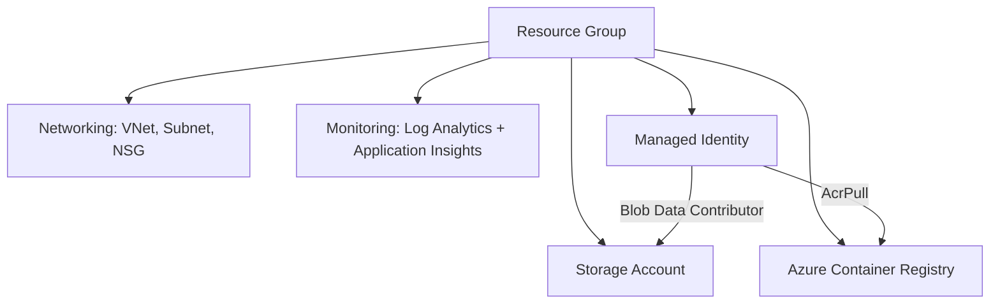

# Terraform Final Project: Azure Infrastructure

## Goal

This project provisions the main Azure infrastructure with Terraform.
A single `terraform apply` creates the Resource Group, networking, storage,
container registry, monitoring and a managed identity, organized in reusable modules.

## Architecture



## Resources created

| Resource | Terraform name | Purpose |
|---|---|---|
| Resource Group | `azurerm_resource_group.main` | Container for all resources |
| Virtual Network | `azurerm_virtual_network.this` | Private network (10.0.0.0/16) |
| Subnet | `azurerm_subnet.app` | Subnet for the application (10.0.1.0/24) |
| Network Security Group | `azurerm_network_security_group.app` | Firewall rules for the subnet |
| Storage Account | `azurerm_storage_account.this` | File storage (private, TLS 1.2) |
| Blob container | `azurerm_storage_container.data` | Private container named `data` |
| Container Registry (ACR) | `azurerm_container_registry.this` | Stores Docker images |
| Log Analytics Workspace | `azurerm_log_analytics_workspace.this` | Collects logs |
| Application Insights | `azurerm_application_insights.this` | Application monitoring |
| Managed Identity | `azurerm_user_assigned_identity.app` | Identity for the app, no passwords |
| Role assignment AcrPull | `azurerm_role_assignment.acr_pull` | Identity can pull images from ACR |
| Role assignment Blob | `azurerm_role_assignment.storage_blob` | Identity can read/write blobs |

## Project structure

```
terraform-lab/
├── providers.tf        # Terraform and Azure provider configuration
├── variables.tf        # Input variables
├── main.tf             # Resource Group, modules and identity
├── outputs.tf          # Values printed after apply
├── terraform.tfvars    # Real values (not committed)
├── .gitignore
├── README.md
└── modules/
    ├── networking/     # VNet, Subnet, NSG
    ├── storage/        # Storage Account and container
    ├── acr/            # Container Registry
    └── monitoring/     # Log Analytics and Application Insights
```

## Modules

Each module has three files: `variables.tf` (inputs), `main.tf` (resources), `outputs.tf` (outputs).
Modules keep the code organized and reusable.

## Variables

| Variable | Description | Default |
|---|---|---|
| `subscription_id` | Azure subscription ID | none (required) |
| `project_name` | Short project name (lowercase letters and numbers) | `lab23` |
| `environment` | Environment name | `dev` |
| `location` | Azure region | `northeurope` |

Note: the region `westeurope` was rejected by Azure
("region not accepting new customers"), so the project uses `northeurope`.

Real values go in `terraform.tfvars`:

```hcl
subscription_id = "My-Sub"
```

## Outputs

| Output | Description |
|---|---|
| `resource_group_name` | Name of the Resource Group |
| `vnet_id` | ID of the Virtual Network |
| `storage_account_name` | Name of the Storage Account |
| `acr_login_server` | Address of the Container Registry |
| `log_analytics_workspace_id` | ID of the Log Analytics workspace |
| `app_identity_client_id` | Client ID of the Managed Identity |

## Prerequisites

- Terraform 1.5 or newer
- Azure CLI
- An Azure subscription

## How to use

1. Sign in to Azure and get the subscription ID:

   ```
   az login
   az account show --query id -o tsv
   ```

2. Put the subscription ID in `terraform.tfvars`.

3. Run Terraform:

   ```
   terraform init
   terraform fmt -recursive
   terraform validate
   terraform plan -out=tfplan
   terraform apply tfplan
   ```

4. When finished, delete everything to avoid costs:

   ```
   terraform destroy
   ```

## Security notes

- The Storage Account is private (no public blob access) and requires TLS 1.2.
- ACR admin user is disabled; access uses a Managed Identity with the `AcrPull` role.
- No passwords or secrets are stored in the code.
- `terraform.tfvars` and `*.tfstate` files are in `.gitignore` and are not committed.

## Manual actions in the Azure portal

None. All resources were created with Terraform.

## Checklist

- [x] IaC
- [x] Variables
- [x] Outputs
- [x] Modules where useful
- [x] README