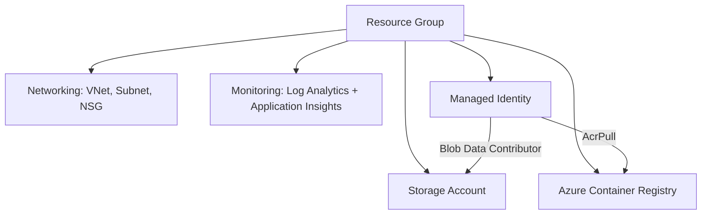
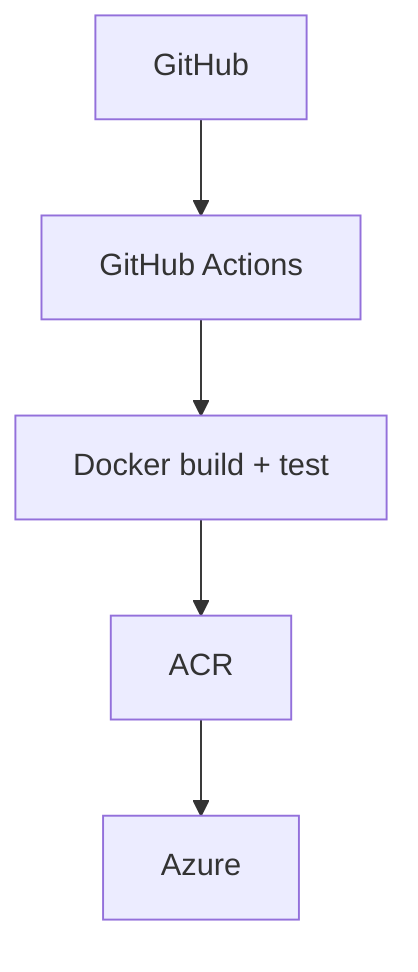

# Azure Infrastructure (Terraform) + Dockerized App

## Goal

This project provisions the main Azure infrastructure with Terraform (Infrastructure as Code)
and contains a small containerized Node.js application with a CI pipeline.

- A single `terraform apply` creates most of the infrastructure.
- A GitHub Actions workflow tests and builds the application on every push.

## Architecture

### Azure infrastructure



### Delivery pipeline



## Part 1: Terraform infrastructure

### Resources created

| Resource | Terraform name | Purpose |
|---|---|---|
| Resource Group | `azurerm_resource_group.main` | Container for all resources |
| Virtual Network | `azurerm_virtual_network.this` | Private network (10.0.0.0/16) |
| Subnet | `azurerm_subnet.app` | Subnet for the application (10.0.1.0/24) |
| Network Security Group | `azurerm_network_security_group.app` | Firewall rules for the subnet |
| Storage Account | `azurerm_storage_account.this` | File storage (private, TLS 1.2) |
| Blob container | `azurerm_storage_container.data` | Private container named `data` |
| Container Registry (ACR) | `azurerm_container_registry.this` | Stores Docker images |
| Log Analytics Workspace | `azurerm_log_analytics_workspace.this` | Collects logs |
| Application Insights | `azurerm_application_insights.this` | Application monitoring |
| Managed Identity | `azurerm_user_assigned_identity.app` | Identity for the app, no passwords |
| Role assignment AcrPull | `azurerm_role_assignment.acr_pull` | Identity can pull images from ACR |
| Role assignment Blob | `azurerm_role_assignment.storage_blob` | Identity can read/write blobs |

### Modules

Each module has `variables.tf` (inputs), `main.tf` (resources) and `outputs.tf` (outputs):
`networking`, `storage`, `acr`, `monitoring`.

### Variables

| Variable | Description | Default |
|---|---|---|
| `subscription_id` | Azure subscription ID | none (required) |
| `project_name` | Short project name (lowercase letters and numbers) | `lab23` |
| `environment` | Environment name | `dev` |
| `location` | Azure region | `northeurope` |

Real values go in `terraform.tfvars` (not committed):

```hcl
subscription_id = "YOUR-SUBSCRIPTION-ID"
location        = "northeurope"
```

### Outputs

| Output | Description |
|---|---|
| `resource_group_name` | Name of the Resource Group |
| `vnet_id` | ID of the Virtual Network |
| `storage_account_name` | Name of the Storage Account |
| `acr_login_server` | Address of the Container Registry |
| `log_analytics_workspace_id` | ID of the Log Analytics workspace |
| `app_identity_client_id` | Client ID of the Managed Identity |

### Prerequisites

- Terraform 1.5 or newer
- Azure CLI
- An Azure subscription

### How to use

```
az login
az account show --query id -o tsv
terraform init
terraform fmt -recursive
terraform validate
terraform plan -out=tfplan
terraform apply tfplan
```

To delete everything and avoid costs:

```
terraform destroy
```

### Security notes

- The Storage Account is private (no public blob access) and requires TLS 1.2.
- ACR admin user is disabled; access uses a Managed Identity with the `AcrPull` role.
- No passwords or secrets are stored in the code.
- `terraform.tfvars`, `.env` and `*.tfstate` files are in `.gitignore` and are not committed.

### Manual actions in the Azure portal

None. All resources were created with Terraform.

Note: the region `westeurope` was rejected by Azure ("region not accepting new
customers"), so the project uses `northeurope`.

## Part 2: Application

A small Node.js web service, packaged with Docker.

### Endpoints

| Endpoint | Response |
|---|---|
| `/` | Welcome message with the app name and environment |
| `/health` | `OK` (used for health checks) |
| `/version` | JSON with name, version and environment |

### Configuration (environment variables)

| Variable | Description | Default |
|---|---|---|
| `APP_ENV` | Environment (`development`, `staging`, `production`) | `development` |
| `PORT` | Port the server listens on | `3000` |
| `LOG_LEVEL` | `error`, `warn`, `info` or `debug` | `info` |
| `APP_NAME` | Application name | `final-project` |
| `APP_VERSION` | Overrides the version from `package.json` | from `package.json` |

No sensitive values are stored in the code. Copy `.env.example` to `.env` for local
configuration; `.env` is ignored by Git. Real secrets belong in `.env` locally and in
GitHub Secrets in CI.

### Logging and error handling

- Logs are written to stdout as JSON, one line per event.
- Unexpected errors return `500`, unknown paths return `404`, non-GET methods return `405`.
- The server shuts down cleanly on `SIGTERM`.

### Run locally

```
npm test
npm start
curl http://localhost:3000/health
```

### Run with Docker

```
docker build -t mia-app .
docker run -d -p 3000:3000 --env-file .env mia-app
curl http://localhost:3000/health
```

Expected response: `OK`

### Continuous integration

On every push, GitHub Actions (`.github/workflows/ci.yml`) runs:

1. **Checkout**: downloads the code
2. **Setup**: installs Node.js 20
3. **Test**: runs `npm test`
4. **Docker build**: builds the image
5. **Test container**: starts the container and checks `/health` and `/version` with `curl`

## Project structure

| File | Purpose |
|---|---|
| `providers.tf`, `variables.tf`, `main.tf`, `outputs.tf` | Terraform root configuration |
| `modules/` | Terraform modules (networking, storage, acr, monitoring) |
| `.terraform.lock.hcl` | Locked provider versions |
| `index.js` | Node.js web service |
| `test.js` | Automated tests for the endpoints |
| `package.json` | App metadata and scripts |
| `Dockerfile` | Builds the application image |
| `.dockerignore` | Files excluded from the image |
| `.env.example` | Template for environment variables |
| `.github/workflows/ci.yml` | CI pipeline |

## Checklist

- [x] IaC
- [x] Variables
- [x] Outputs
- [x] Modules where useful
- [x] README
- [x] Endpoints `/`, `/health`, `/version`
- [x] Logging and error handling
- [x] Environment variables and external configuration